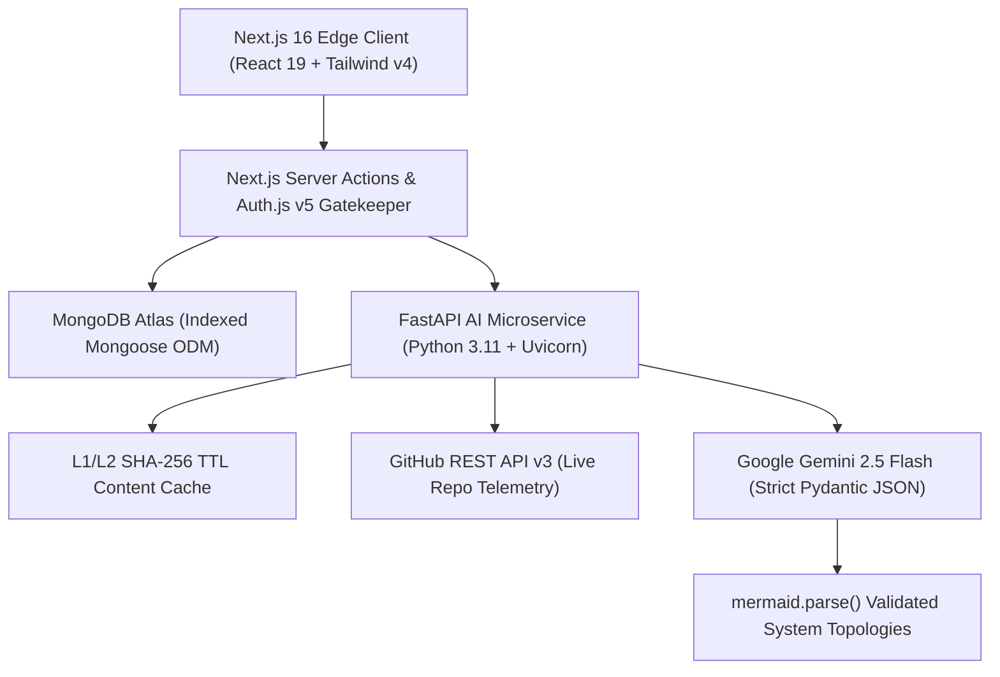

# ⚡ SyncStack Enterprise (v2.1)
### Autonomous Project Architecture, Anti-Hallucination Skill Verification & Multi-Vector Workforce Orchestration Platform


> **Built for TCS Zeta Innovate 2026** — *Transforming raw engineering concepts into validated system architectures and matching verified technical talent using deterministic Generative AI pipelines.*

---

## 🎯 1. Problem Statement & Enterprise Impact

Large-scale engineering organizations, academic incubators, and R&D hubs face three systemic bottlenecks when assembling technical teams:
1. **Unverified Self-Reported Skills:** Traditional talent pools rely on static resumes where claimed skills rarely reflect actual code complexity or repository history.
2. **Unstructured Project Scoping:** Project leads pitch high-level ideas without concrete microservice topologies, sprint breakdowns, or risk mitigations, causing early execution stalls.
3. **Keyword-Only Matchmaking:** Legacy matching tools compare raw text strings rather than evaluating **semantic capability overlap**, role complementarity, and verified developer trust scores.

**SyncStack Enterprise** solves all three challenges through a decoupled **Next.js 16 + FastAPI** microservice architecture powered by **Google Gemini 2.5 Flash** and **Pydantic structured output enforcement**.

---

## 🏗️ 2. System Architecture & Data Flow

SyncStack separates high-concurrency web rendering from compute-intensive AI orchestration:



---

## ✨ 3. Core Enterprise Capabilities

### 🧠 A. Autonomous Project Architect (`/api/v1/architect-project`)
* Converts a raw 1–2 sentence concept into an executive technical blueprint in one click.
* Generates **recommended tech stacks**, **3-phase implementation sprints with estimated engineering hours**, **specialized workforce role matrices**, and **technical risk mitigation strategies**.
* Synthesizes **Mermaid.js system topology diagrams** validated client-side via `mermaid.parse()` before rendering interactive SVG flowcharts.

### 🛡️ B. Anti-Hallucination GitHub Skill Verifier (`/api/v1/verify-skills`)
* Connects directly to the **GitHub REST API** to inspect a developer's public repositories, primary languages, star velocity, and descriptions.
* Cross-audits live repository evidence against claimed skills using **Gemini 2.5 Flash** to issue an **Overall Enterprise Trust Score (0–100%)**, per-skill confidence bars, verifiable evidence logs, and an AI-recommended enterprise role.

### 🤝 C. Explainable Multi-Vector Matchmaking (`/api/v1/match-teammates`)
* Evaluates candidates across **Semantic Skill Space Overlap**, **Role Fit**, and **Verified Trust Telemetry**.
* Produces a ranked compatibility breakdown highlighting **Matching Strengths**, **Skill Gaps / Ramp-Up Areas**, and a **1-Click AI Recruitment Icebreaker Pitch**.

### 📊 D. Workforce Command Center & Global Roster
* **Executive Dashboard (`/dashboard`):** Real-time KPI telemetry ribbon tracking inbound talent queues, pending reviews, confirmed matches, and outbound pitches with privacy-preserving contact reveals upon acceptance.
* **Global Leaderboard (`/leaderboard`):** ISR-cached developer rankings sorted by shipped architectures, peer reputation, and AI-verified trust scores.

---

## ⚙️ 4. Production Engineering & Resilience Highlights

| Engineering Pillar | Implementation Details |
| :--- | :--- |
| **Deterministic AI Outputs** | Enforced via strict **Pydantic v2 `response_schema`** contracts in FastAPI—eliminating LLM markdown drift or malformed JSON. |
| **3-Tier Hybrid Caching** | **L1 In-Memory Hash Map** + **L2 Disk Persistence (`ai_cache.json`)** keyed by SHA-256 payload fingerprints with a 24-hour TTL, plus **L3 MongoDB Document Persistence** (<0.5ms cache hit latency, 0 wasted API credits). |
| **Graceful Degradation** | Every Server Action (`src/actions/ai.ts`) and UI modal includes deterministic fallback schemas and exponential backoff cooldowns so live operations never fail under API rate limits. |
| **Database Indexing** | Compound indexes on `Project ({ status: 1, createdAt: -1 })` and `User ({ reputation_score: -1, trust_score: -1 })` prevent collection scans at scale. |

---

## 🚀 5. Quick Start & Local Installation

### Prerequisites
* **Node.js** `>= 20.9.0`
* **Python** `>= 3.11`
* **MongoDB Atlas URI** & **Google Gemini API Key**

### 1. Clone & Configure Environment
```bash
git clone [https://github.com/bhargavaalapati/SyncStack.git](https://github.com/bhargavaalapati/SyncStack.git)
cd SyncStack
```

Create a `.env` file in the root directory:
```env
MONGODB_URI="mongodb+srv://<user>:<password>@cluster.mongodb.net/syncstack"
AUTH_SECRET="your-32-character-secret"
NEXTAUTH_URL="http://localhost:3000"
AUTH_GITHUB_ID="your-github-oauth-client-id"
AUTH_GITHUB_SECRET="your-github-oauth-client-secret"
AI_ENGINE_BASE_URL="[http://127.0.0.1:8000](http://127.0.0.1:8000)"
```

Create an `ai-engine/.env` file:
```env
GEMINI_API_KEY="your-gemini-api-key"
```

### 2. Start the FastAPI AI Microservice
```bash
cd ai-engine
python -m venv venv
source venv/bin/activate  # On Windows Git Bash: source venv/Scripts/activate
pip install -r requirements.txt
uvicorn main:app --reload --port 8000
```
*Swagger OpenAPI documentation is available at `http://127.0.0.1:8000/docs`.*

### 3. Start the Next.js 16 Web Application
```bash
npm install
npm run dev
```
*Open `http://localhost:3000` in your browser.*

### 4. Run via Docker Compose (Single-Command Container Orchestration)
```bash
docker compose up --build
```

---

## 🧪 6. Enterprise Demo Seeding

To populate the database with idempotent enterprise architectures, pre-computed AI blueprints, and verified engineer profiles for evaluation:
```bash
curl "http://localhost:3000/api/seed?key=hackathon2026"
```

---

## 📁 7. Repository Structure

```text
SyncStack/
├── ai-engine/                  # Decoupled Python FastAPI GenAI Microservice
│   ├── main.py                 # Gemini 2.5 Flash endpoints + SHA-256 TTL Cache
│   ├── requirements.txt        # Python dependencies
│   └── Dockerfile              # Microservice container specification
├── src/
│   ├── actions/                # Next.js Server Actions (ai.ts, project.ts, profile.ts, application.ts)
│   ├── app/                    # App Router pages (/bulletin, /dashboard, /leaderboard, /profile, /api/seed)
│   ├── components/             # UI & Enterprise Modals (BlueprintModal, SuggestTeammates, MermaidDiagram)
│   ├── lib/                    # MongoDB connection pooling & utilities
│   └── models/                 # Indexed Mongoose schemas (User.ts, Project.ts, Application.ts)
├── Dockerfile.next             # Next.js 16 Node 20 Alpine container specification
└── docker-compose.yml          # Multi-container orchestration bridge
```

---
*Developed by **Alapati Bhargava Rama Bharadwaja** for Zeta Innovate 2026.*