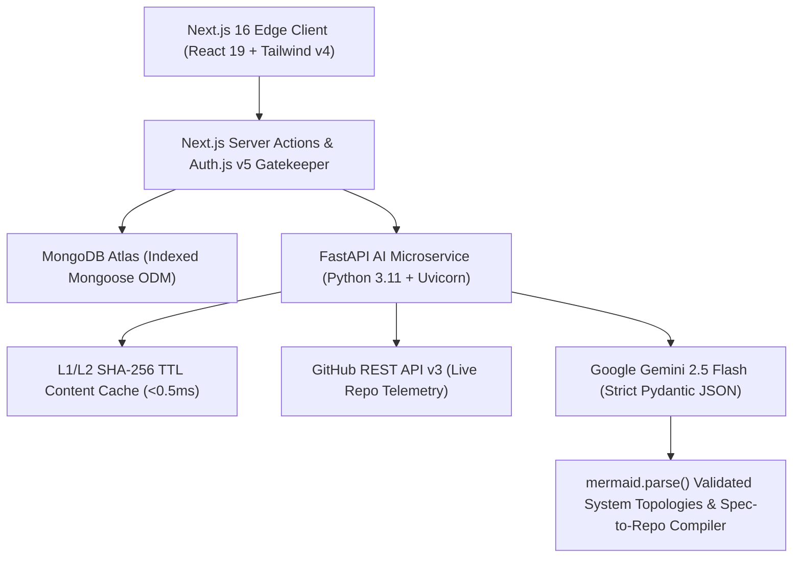

# ⚡ SyncStack Enterprise (v2.5)

### Autonomous Project Architecture, Anti-Hallucination Skill Verification, Spec-to-Repo Compiler & Multi-Vector Workforce Orchestration Platform


> **Built for TCS Zeta Innovate 2026** — *Transforming raw engineering concepts into validated system architectures, executable monorepo scaffolds, and verified technical talent pairing using deterministic Generative AI pipelines.*

---

## 🎯 1. Problem Statement & Enterprise Impact

Large-scale engineering organizations, academic incubators, and R&D hubs face critical bottlenecks when assembling technical teams and initializing software projects:

1. **Unverified Self-Reported Skills & Resume Fraud:** Traditional talent pools rely on static resumes where up to 30%-50% of applicant profiles feature synthetic or exaggerated skill claims.
2. **Sprint 0 Architectural Paralysis:** Teams lose crucial hours debating vague project scopes without concrete microservice topologies, sprint breakdowns, or automated repository scaffolding.
3. **Keyword-Only Matchmaking:** Legacy tools compare raw text strings rather than evaluating **semantic capability overlap**, role complementarity, and verified GitHub trust telemetry.

**SyncStack Enterprise** solves these challenges through a decoupled **Next.js 16 + FastAPI** microservice architecture powered by **Google Gemini 2.5 Flash**, **Pydantic structured output enforcement**, **Zero-Trust Cloudflare security gates**, and a **Bi-Directional Spec-to-Repo Compiler**..

---

## 🏗️ 2. System Architecture & Data Flow

SyncStack separates high-concurrency web rendering from compute-intensive AI orchestration:



---

## ✨ 3. Core Enterprise Capabilities

### 🧠 A. Autonomous Project Architect (`/api/v1/architect-project`)

* Converts a raw 1–2 sentence concept into an executive technical blueprint in one click.
* Generates **recommended tech stacks**, **3-phase implementation sprints with estimated engineering hours**, **specialized workforce role matrices**, and **technical risk mitigation strategies**.
* Synthesizes **Mermaid.js system topology diagrams** validated client-side via `mermaid.parse()` before rendering interactive SVG flowcharts.

### ⚡ B. Bi-Directional Spec-to-Repo Compiler ("Sprint 0 in 60 Seconds")

* Compiles any generated Mermaid.js blueprint into an executable monorepo initialization script (`scaffold-service.sh`).
* Auto-provisions directory structures (`filetree`), `docker-compose.yml`, OpenAPI/Pydantic contract stubs, `AGENTS.md` context files for AI agents, and pre-assigned Git feature branches per role.

### 🛡️ C. Anti-Hallucination GitHub Skill Verifier & 10-Min Micro-PR AST Sandbox

* Connects directly to the **GitHub REST API** to inspect public repositories, primary languages, star velocity, and commit depth.
* Features an **Ephemeral Micro-PR AST Debugging Sandbox** where developers diagnose and patch concurrent race conditions to earn an elite "Senior Builder" trust badge.

### 🤝 D. Explainable Multi-Vector Matchmaking & Autonomous RAG Lobby Agent

* Evaluates candidates across **Semantic Skill Space Overlap**, **Role Fit**, and **Verified Trust Telemetry** with natural-language affinity justifications.
* Includes a floating **Developer Comms Lobby** featuring real-time presence heartbeats (`🟢 Online Now` via 20s TTL), `@Reply` quotes, and the **@SyncStack-Agent** (a zero-token MongoDB RAG concierge).

### 📊 E. Workforce Command Center & Global Roster

* **Executive Dashboard (`/dashboard`):** Real-time KPI telemetry ribbon tracking inbound talent queues, pending reviews, confirmed matches, and outbound pitches with privacy-preserving contact reveals upon acceptance.
* **Global Leaderboard (`/leaderboard`):** ISR-cached developer rankings featuring 14-day GitHub/LeetCode-style contribution heatmaps, active streak counters, and Daily Check-In RepCoins (`+25`).

---

## ⚙️ 4. Production Engineering & Resilience Highlights

| Engineering Pillar | Implementation Details |
| --- | --- |
| **Deterministic AI Outputs** | Enforced via strict **Pydantic v2 `response_schema`** contracts in FastAPI—eliminating LLM markdown drift or malformed JSON. |
| **3-Tier Hybrid Caching** | **L1 In-Memory Hash Map** + **L2 Disk Persistence (`ai_cache.json`)** keyed by SHA-256 payload fingerprints with a 24-hour TTL, plus **L3 MongoDB Document Persistence** (<0.5ms cache hit latency, 0 wasted API credits). |
| **Zero-Trust Security** | **Cloudflare Turnstile bot verification** on authentication gates, multi-provider OAuth 2.0 (GitHub, Google, GitLab, Microsoft, Slack), and 60-second anti-spam cooldown timers. |
| **Database Indexing** | Compound indexes on `Project ({ status: 1, createdAt: -1 })`, `User ({ reputation_score: -1, trust_score: -1 })`, and `Message ({ createdAt: -1 })` prevent collection scans at scale. |

---

## 🚀 5. Quick Start & Local Installation

### Prerequisites

* **Node.js** `>= 20.9.0`
* **Python** `>= 3.11`
* **MongoDB Atlas URI** & **Google Gemini API Key**

### 1. Clone & Configure Environment

```bash
git clone https://github.com/bhargavaalapati/SyncStack.git
cd SyncStack

```

Create a `.env` file in the root directory:

```env
MONGODB_URI="mongodb+srv://<user>:<password>@cluster.mongodb.net/syncstack"
AUTH_SECRET="your-32-character-secret"
NEXTAUTH_URL="http://localhost:3000"
AUTH_GITHUB_ID="your-github-oauth-client-id"
AUTH_GITHUB_SECRET="your-github-oauth-client-secret"
AUTH_GOOGLE_ID="your-google-client-id"
AUTH_GOOGLE_SECRET="your-google-client-secret"
AUTH_GITLAB_ID="your-gitlab-app-id"
AUTH_GITLAB_SECRET="your-gitlab-secret"
NEXT_PUBLIC_TURNSTILE_SITE_KEY="your-cloudflare-site-key"
TURNSTILE_SECRET_KEY="your-cloudflare-secret-key"
AI_ENGINE_BASE_URL="http://127.0.0.1:8000"

```

Create an `ai-engine/.env` file:

```env
GEMINI_API_KEY="your-gemini-api-key"

```

### 2. Start the FastAPI AI Microservice

```bash
cd ai-engine
python -m venv venv
source venv/bin/activate  # On Windows Git Bash: source venv/Scripts/activate
pip install -r requirements.txt
uvicorn main:app --reload --port 8000

```

*Swagger OpenAPI documentation is available at `[http://127.0.0.1:8000/docs](http://127.0.0.1:8000/docs)`.*

### 3. Start the Next.js 16 Web Application

```bash
npm install
npm run dev

```

*Open `http://localhost:3000` in your browser.*

### 4. Run via Docker Compose (Single-Command Container Orchestration)

```bash
docker compose up --build

```

---

## 🧪 6. Enterprise Demo Seeding

To populate the database with idempotent enterprise architectures, pre-computed AI blueprints, and verified engineer profiles for evaluation:

```bash
curl "http://localhost:3000/api/seed?key=hackathon2026"

```

---

## 📁 7. Repository Structure

```text
SyncStack/
├── ai-engine/                  # Decoupled Python FastAPI GenAI Microservice
│   ├── main.py                 # Gemini 2.5 Flash endpoints + SHA-256 TTL Cache
│   ├── requirements.txt        # Python dependencies
│   └── Dockerfile              # Microservice container specification
├── src/
│   ├── actions/                # Next.js Server Actions (ai.ts, project.ts, profile.ts, application.ts, ship.ts, chat.ts)
│   ├── app/                    # App Router pages (/bulletin, /chat, /dashboard, /leaderboard, /profile, /api/seed)
│   ├── components/             # UI & Enterprise Modals (BlueprintModal, SuggestTeammates, MermaidDiagram, SpecToRepoCompiler, GlobalChatDrawer, DevProgressionCard)
│   ├── lib/                    # MongoDB connection pooling & utilities
│   └── models/                 # Indexed Mongoose schemas (User.ts, Project.ts, Application.ts, Message.ts)
├── Dockerfile.next             # Next.js 16 Node 20 Alpine container specification
└── docker-compose.yml          # Multi-container orchestration bridge

```

---

*Developed by **Alapati Bhargava Rama Bharadwaja** for Zeta Innovate 2026.*